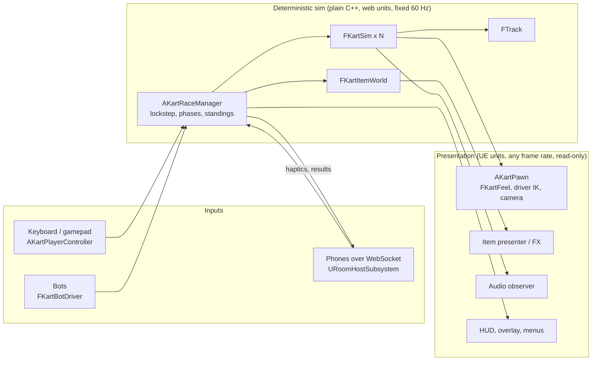

# Architecture

Movecade Kart Racer is a split-screen party kart racer in Unreal Engine 5.8. Players steer with a gamepad, the
keyboard, or by tilting their phone. It is a port of a shipped web game (three.js), so the most important design
constraint was that **the race plays exactly like the original** while everything around it (rendering, feel, UI)
moves up to console quality.

This page explains how the code is organised, why, and how it is tested. All C++ lives in one runtime module,
`Source/MovecadeKart`.

## The one rule: simulation and presentation never mix

- **The sim** (`Public/Sim`, `Private/Sim`) is plain C++ with no UObjects, no engine time and no randomness that
  isn't seeded. It works in the web game's units (metres, three.js axes), so every constant in the specs ports
  verbatim and every behaviour can be checked against the original. `FKartSim::Step` advances one kart by exactly
  1/60 s, and `FKartItemWorld` advances every item, projectile and box.
- **The race layer** (`AKartRaceManager`) owns the fixed-step accumulator. Each step it gathers one `FKartInput`
  per seat, from a local controller, a phone or a bot, then steps every kart in lockstep. It also runs the
  phases (waiting, intro, countdown, racing, finished), places, laps and results.
- **The presentation** reads sim state and never writes it. `UKartMovementComponent` interpolates the pose between
  steps for smooth rendering at any frame rate. `AKartPawn` drives the art: wheels, steering, the skinned driver,
  the chase camera and the feel layer. Audio, FX and UI all observe the same state.

That split is what makes the rest possible: bots and phones are just input sources, the replay of a race is
deterministic, the gameplay is unit-testable without a world, and the "AAA juice" can be added or switched off
(`-KartWebFeel`) without touching how the game plays.

Coordinates convert at exactly one boundary, `KartCoords.h`: `UE.X = -z·100, UE.Y = x·100, UE.Z = y·100`,
and UE yaw is the negated three.js yaw.

## Module map

| Area | Files | What it does |
|---|---|---|
| Sim | `Sim/KartSim`, `Sim/KartTrack`, `Sim/KartItems` | Drivetrain, steering, drift tiers, boosts, walls, recovery; track data (walls, checkpoints, waypoints, pads, dirt); 11 items with position-weighted odds |
| Race | `Race/KartRaceManager`, `Race/KartBotDriver`, `Race/KartItemPresenter`, `Race/SKartRaceOverlay` | Lockstep stepping, phases, standings, bots, item visuals, pause menu |
| Kart | `KartPawn`, `KartMovementComponent`, `KartDriverAnimInstance`, `KartLook` | The kart actor, pose interpolation, the procedural driver pose (two-bone IK onto the wheel), character and vehicle looks |
| Feel | `Feel/KartFeel` | Presentation-only springs: chassis pitch, roll, heave and squash; camera FOV kick, drift swing, bank, dip, rumble |
| Rendering | `Render/KartGameUserSettings`, `Render/KartRenderQualitySubsystem`, `Render/KartGradeSubsystem`, `Render/KartRenderBudget` | Graphics presets, ray tracing and motion blur settings; split-screen budgets, dynamic resolution and a frame-time guard that hold 60 fps; the project-wide colour grade |
| Capture | `Capture/KartCaptureSubsystem`, `Tools/video` | Fixed-step frame capture and a cinematic camera, encoded to MP4 for trailers |
| Tracks | `TrackBuilder`, `TrackScenery`, `Tools/track-export` | Builds the road, walls and scenery from exported JSON |
| Network | `Net/RoomHostSubsystem`, `Net/RoomProtocol`, `Net/QrCode`, `Net/KartLobbyWidget` | Hosts a PartyKit room: lobby, QR join, phone sensor frames to inputs, haptics, signed results |
| Audio | `Audio/*` | Engine layers, drift, surfaces, impacts and cues, synthesised to match the web mix |
| Game | `KartGameMode`, `KartPlayerController`, `KartGameViewportClient`, `KartHUD` | Local or room races, Enhanced Input built in code, split-screen layout, HUD |

## Rendering

Hardware ray tracing drives Lumen GI and reflections (with hit lighting at the top preset), shadows are virtual shadow
maps, and TSR upscales. RT shadows were measured and rejected: about 2 ms more GPU for no visible gain.
`UKartRenderQualitySubsystem` counts the local views. In split screen it caps the expensive groups, and in every
mode it drives dynamic resolution toward a 16.6 ms budget. A frame-time guard steps GI, reflections and shadows down
(and back up) only when resolution is already at its floor. The player's saved settings are never changed: the trims
use Scalability's temporary levels. The colour grade is one unbound post-process volume at low priority, so each
track's own lighting layers on top.

## Decisions worth knowing

- **A kinematic kart, not Chaos Vehicles.** The original handling is arcade maths tuned per frame. A physics
  vehicle could only approximate it, and would make the race non-deterministic. The kart is a sphere-root pawn
  moved by the sim.
- **Tracks are data.** A Node exporter (`Tools/track-export`) reads the web game's track modules and writes
  `Data/Tracks/*.track.json`: centreline, walls, checkpoints, boost pads, item boxes and scenery placements.
  `FTrack` loads the gameplay data and `ATrackBuilder` builds the visuals from the same file, so the art can be
  rebuilt completely (as Violet Loop was) without moving a single wall.
- **Parity first, fixes on purpose.** The web game had real bugs: item hits that never slowed anyone, sticky
  walls, a camera fighting itself. Each one is listed in [Docs/Port/00-PLAN.md](Port/00-PLAN.md) with the
  decision taken, and the behavioural fixes keep a switch to the original (`-KartLegacyWalls`).
- **No editor-only assets for logic.** Input actions, the driver's animation (a native `FAnimInstanceProxy`) and
  the HUD are built in code, so the logic is reviewable as text and diffable.

## Testing

`.\Tools\ue\test.ps1` builds the editor target and runs every automation test headless. The tests fall into four groups:

- **Sim:** lap counting, turn rate, drift tiers and release, pedal envelope, walls holding on both tracks, and an
  autopilot that must lap each track inside a fixed time window with no respawns.
- **Determinism:** four mixed-skill bots race a minute in a pack (contact, slipstream, rubber-banding, items), twice.
  Every kart must end bit-identical, with the same item events on the same steps; a different item seed must give
  a different race. This test caught that Violet Loop's bots never collected an item.
- **Bots:** every difficulty laps both tracks with no respawns, and Easy, Normal and Hard rank in order on time.
- **Items:** odds brackets, roulette, the bomb and shot effects.
- **Net and audio:** golden tests against values captured from the web build. These cover the protocol
  messages, sensor-frame decoding, steering mapping, QR reference matrices, and the engine and mix curves.
- **Feel, art and rendering:** spring stability across frame rates, chassis and camera responses, deterministic
  looks, and the render budget tables (presets, split-screen caps, guard steps).

`.\Tools\ue\play.ps1` runs the real game with test hooks (`-KartAutoDrive`, `-KartShots=t1,t2`,
`-KartQuitAfter=N`). That gives visual checks and end-to-end runs: a bot drives, screenshots are taken, and the
game quits. `Tools/net-sim/e2e.ps1` races a simulated phone against bots through a local PartyKit server.
